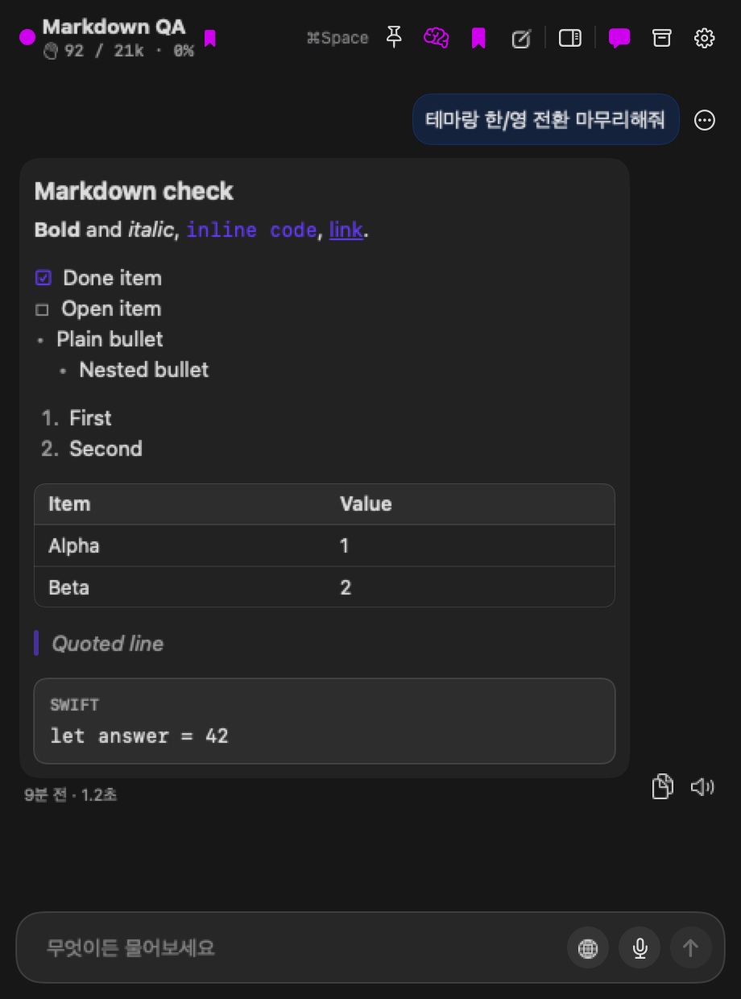

# QuickTalk

macOS 메뉴바에서 단축키 한 번으로 부르는 **AI 대화 앱**. SwiftUI + AppKit, macOS 14+.

원격 OpenAI 호환 API를 주 모델로, Apple FM(온디바이스)·Ollama(로컬)을 예비/보조로 쓴다.
대화는 자동 저장되고, 길어지면 스스로 요약해 문맥을 정리한다.



## 기능

- **대화** — 스트리밍 출력, 응답 중지(⏹), 복사(마크다운 원문), 읽어주기(TTS), 응답 시각·소요 시간
- **모델** — Apple FM(온디바이스) / Ollama(로컬) / OpenAI 호환(원격), 실패 시 예비 모델로 1회 폴백
- **웹 검색** — 필요한 질문만 모델이 Y/N으로 판정해 Exa 검색 → `[n]` 인용 + 출처 카드, 🌐로 강제 검색
- **대화 기억** — 입력 예산 70%를 넘으면 답변 후 백그라운드 요약, 원문은 화면·보관함에 그대로
- **공통 메모리** — 여러 대화에 걸쳐 쓰는 사용자 정보(선택)
- **보관함** — 대화 자동 저장·검색(찾은 턴으로 이동)·제목 변경·삭제 확인·마지막 대화 시간
- **QuickShelf** — 클립보드·파일·화면 캡처 허브(창 안 오버레이 또는 가장자리 패널)
- **캡처 / 음성** — 영역·창 캡처, 받아쓰기(Apple/Whisper), 읽어주기(Apple/Edge/Piper TTS)
- **단축키** — 호출·퀵셸프·캡처 5종을 설정에서 직접 녹화해 변경, 충돌 검사

## 요구 사항

- macOS 14 (Sonoma) 이상
- Xcode 16 이상 (빌드)
- 선택: [Ollama](https://ollama.com), `edge-tts`/`piper`, Exa API 키(웹 검색), Whisper 모델

## 빌드

```bash
git clone https://github.com/BoraSarang/QuickTalk.git
cd QuickTalk

# 코어 로직 테스트 (앱 타깃은 Xcode 빌드)
swift test

# 앱 빌드 (Debug)
xcodebuild -project QuickTalk.xcodeproj -scheme QuickTalk -configuration Debug \
  -destination 'platform=macOS' -derivedDataPath build build

open build/Build/Products/Debug/QuickTalk.app
```

소스가 추가/삭제되면 `project.yml`에서 프로젝트를 다시 만든다.

```bash
xcodegen generate --spec project.yml
```

## 설정

앱 실행 → 헤더 ⚙️ 또는 메뉴바 아이콘 → 설정.

- **AI** — 활성/예비 모델, API 주소·모델 이름, Exa 검색(키는 macOS 키체인 `SecretStore`에 저장)
- **대화 기억 정리** — 자동 정리 토글, 최근 원문 수, [지금 정리]
- **음성** — 받아쓰기 엔진, 읽어주기 엔진과 목소리·속도
- **단축키** — 호출·퀵셸프·캡처 조합 변경(중복·선점 검사)
- **보관함** — 자동 저장 보관일수, 전체 삭제

API 키는 코드·설정 파일에 하드코딩하지 않는다(키체인 저장, 로그에 본문·키를 남기지 않음).

## 구조

```
Sources/QuickTalkCore/   순수 로직 — 모델, 저장, LLM 클라이언트, 검색, 기억 정리, 마크다운
QuickTalkApp/            SwiftUI/AppKit UI — 창·메뉴바, 입력창, QuickShelf, 캡처, 음성
Tests/QuickTalkCoreTests/ 코어 테스트 (swift test)
docs/                    설계·핸드오프·QA 기록, 오프스크린 렌더
```

## 개발 노트

- 대화 기록: `~/Library/Application Support/QuickTalk/history.json`
- 공통 메모리: `~/Library/Application Support/QuickTalk/memory.json` (`0600`)
- QA용 오프스크린 렌더: `QuickTalk.app/Contents/MacOS/QuickTalk --render=<폴더> --demo-chat --lang=korean --theme=dark`
- UI 상태(`@Published`)는 반드시 메인 액터에서만 갱신한다(백그라운드 갱신은 AppKit 예외로 앱을 죽인다).

## 라이선스

개인 프로젝트 — 별도 라이선스를 두지 않는다. 코드 사용 전 문의.
