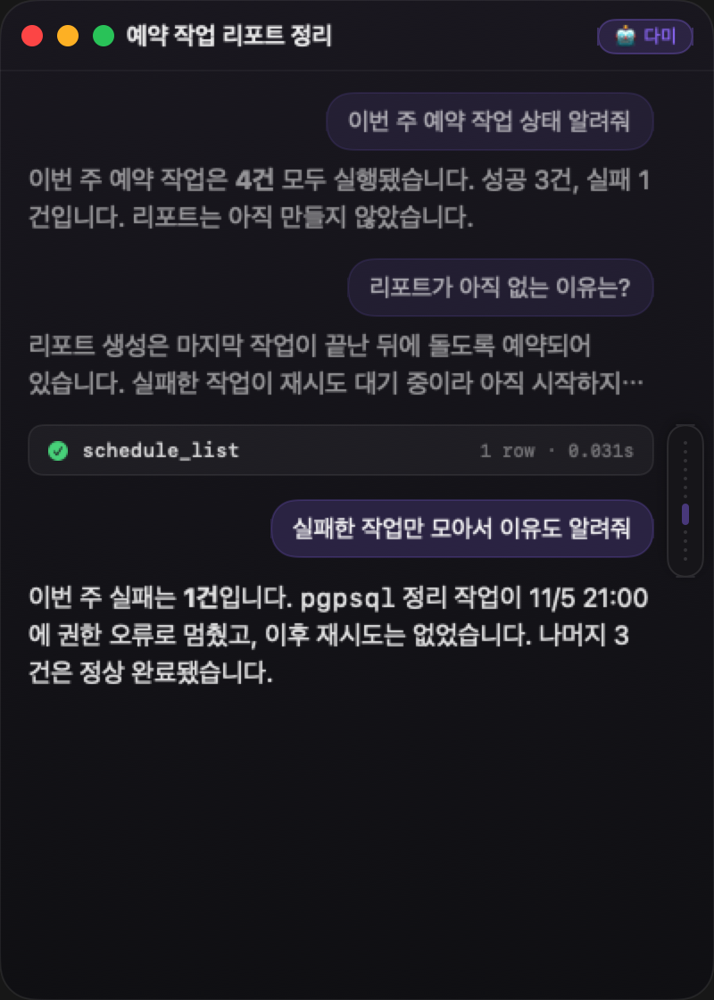
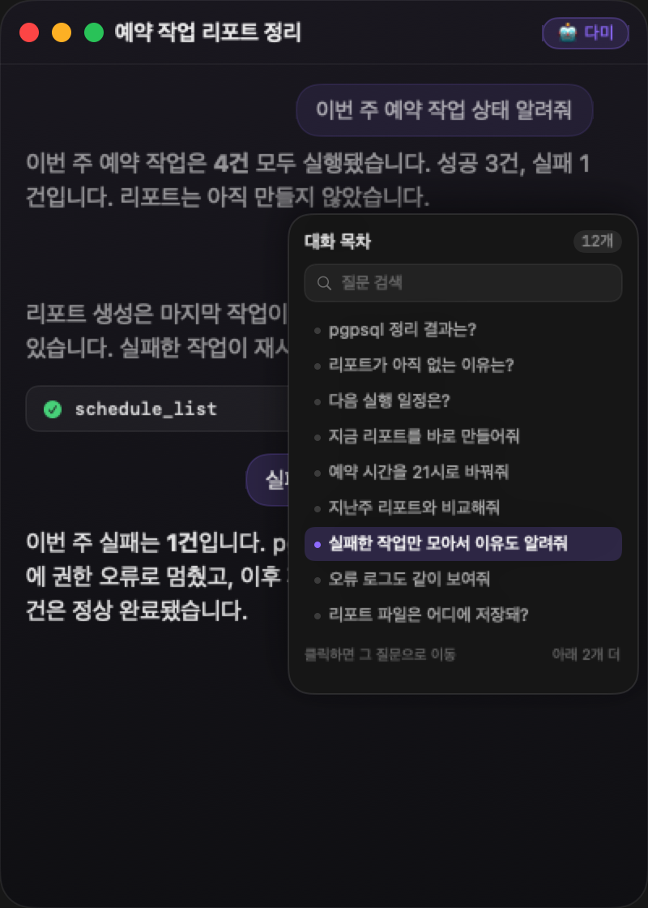
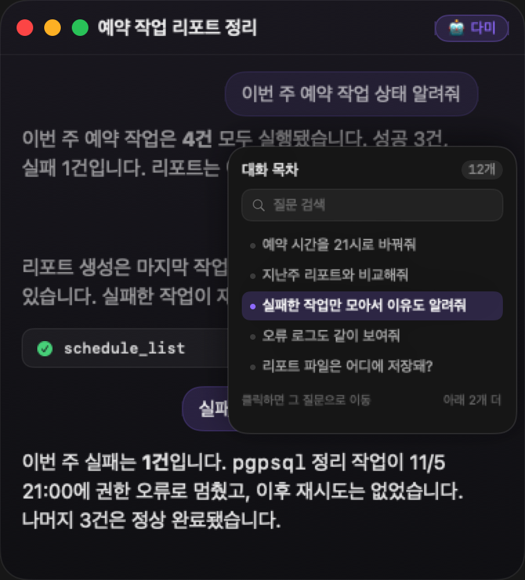
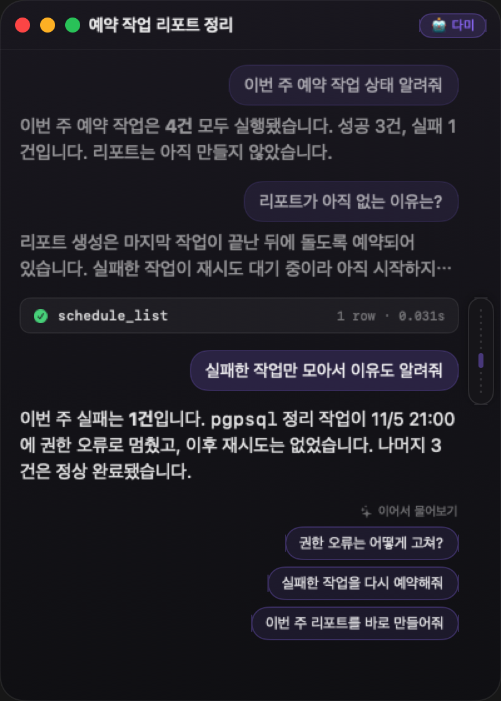
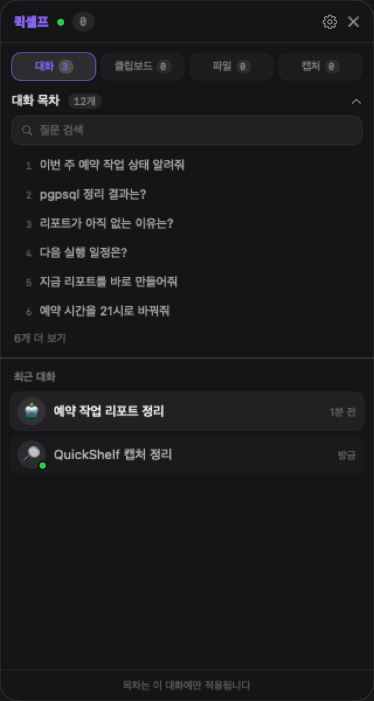
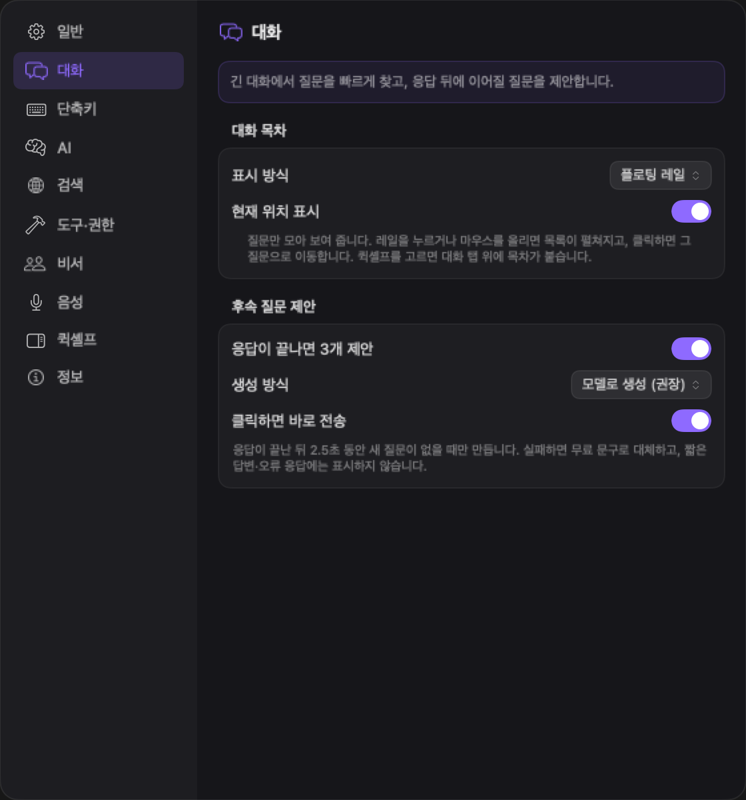

# v0.32 대화 목차 · 후속 질문 제안 — 목업 QA + 실제 화면

> 상태: **구현·검증·병합·배포 완료 — 실측 대기** (2026-11-06)
> v0.32.1 수정 포함: 레일·질문 `⋯` 여백 30pt · 바로가기 후 스크롤이 맨 아래로 튀던 문제.
> 계획: `docs/plans/PLAN_v0.32_outline-followups_macos.md`
> 목업 코드: `QuickTalkApp/DesignMockView+Outline.swift` (렌더 하네스 전용)
> 실제 화면: `live-*.png` — `QuickTalk --render=<dir> --lang=korean|english --theme=dark|light --demo-outline-live`
> 목업 재현: `QuickTalk --render=<dir> --lang=korean --theme=dark --demo-outline`

---

## 1. 이미지

### 1.1 접힌 레일

- 평상시에는 **폭 22pt 미니맵**만 남는다. 질문 12개 = 눈금 12개, 지금 읽는 질문 = 보라색 막대.
- 대화 본문은 오른쪽 30pt(레일 28pt + 2pt)를 비우고 그대로 쓴다 — 레일이 글자를 가리지 않고,
  질문 `⋯`(오른쪽 끝 34pt)도 레일과 겹치지 않는다.

### 1.2 펼친 목차

- 호버 0.35초 또는 클릭 → 질문 목록. **현재 질문이 보이도록** 스크롤된 상태(가운데 아래).
- 질문 첫 줄 40자, 넘치면 `…`. 바닥에 `아래 2개 더`.
- 패널은 오버레이다 — 이때 본문 폭을 줄이면 글자가 5자마다 끊긴다(1차 목업에서 확인하고 되돌렸다).

### 1.3 좁은 창 (380×420 · 최소 크기)

- 패널 208×220 = 창 폭의 55%·높이의 52%. 보이는 질문 5개.
- 최소 크기에서도 제목·질문·답변이 위아래로 남아 **맥락을 잃지 않는다**.

### 1.4 후속 질문

- 마지막 답변 **아래**, 우측 정렬 칩 3개 + `✦ 이어서 물어보기`.
- 칩은 답변 말풍선/메타 줄과 분리되어 복사·읽어주기 버튼과 섞이지 않는다.

### 1.5 두 기능 함께

- 목차(접힌 레일) + 후속 질문. 둘 다 켜도 서로 겹치지 않는다.

### 1.6 QuickShelf 보조 진입

- 대화 탭 최상단 접이식 `대화 목차 12개`, 최근 6개 + `6개 더 보기`, 아래에 기존 최근 대화.
- 칩을 누르면 셸프를 닫고 그 질문으로 이동한다(구현 시).

### 1.7 설정 › 대화

- **대화 목차**: 표시 방식(끔/플로팅 레일/퀵셸프/둘 다) · 현재 위치 표시.
- **후속 질문 제안**: 응답이 끝나면 3개 · 생성 방식(모델/무료 문구) · 클릭하면 바로 전송.

### 1.8 English

| 파일 | 화면 |
| --- | --- |
| `outline-collapsed-en.png` · `outline-expanded-en.png` | 레일·목차 |
| `outline-followups-en.png` · `outline-both-en.png` | 후속 질문 |
| `outline-narrow-en.png` | 최소 창 |
| `shelf-outline-en.png` | QuickShelf 목차 |
| `settings-conversation-en.png` | 설정 |

영어는 질문이 길어 40자에서 더 많이 잘린다(예: `What did the pgpsql cleanup re…`). 목록 폭을 216으로 둔 트레이드오프이며, 검색으로 보완한다.

### 1.9 실제 화면 (구현 후 렌더)

목업을 `ContentView`·`ShelfView`·`SettingsView` 에 연결한 결과. `--demo-outline-live` 렌더 분기로 **메모리에만** 견본 대화를 넣는다(저장 없음).

| 파일 | 화면 |
| --- | --- |
| `live-outline-rail-ko.png` | 400×560 · 접힌 눈금 레일 + 현재 위치 |
| `live-outline-hover-ko.png` | 400×560 · 두 번째 질문에 호버 — `⋯` 와 레일 간격 |
| `live-outline-panel-ko.png` | 400×560 · 펼친 목차(현재 질문 중심) |
| `live-outline-panel-bottom-ko.png` | 바닥까지 내려간 상태에서 펼침 |
| `live-outline-narrow-ko.png` | 380×420 최소 창 |
| `live-followups-ko.png` | 답변 아래 후속 질문 칩 3개 |
| `live-shelf-outline-ko.png` | QuickShelf 대화 탭 목차 |
| `live-settings-conversation-ko.png` | 설정 › 대화 두 그룹(780×1500) |
| `live-*-en.png` | 같은 화면 영어(라이트) |

**렌더에서 확인한 것**: 레일이 본문을 가리지 않음(오른쪽 30pt) · 질문 `⋯` 와 레일 사이 6pt · 펼친 패널이 리플로우를 만들지 않음 · 380×420 에서 패널이 창을 벗어나지 않음 · 바닥에서는 마지막 질문이 강조됨 · 칩이 답변 메타 줄과 섞이지 않음 · 설정에서 레일을 끄면 위치 토글이 숨는다.

**미실행**: `--session-test` — 실행 중 QuickTalk 인스턴스가 단일 인스턴스 잠금(`E-MAC-APP-0001`)을 잡고 있어 중복 실행이 차단됐다(사용자 앱 중단 방지). 이번 변경은 세션 분리 경로를 건드리지 않았고 `swift test` 891/891 로 대체 확인했다. 앱을 종료한 뒤 `QuickTalk --session-test` 로 재확인할 수 있다.

### 1.10 v0.32.2 — 후속 질문 칩이 늦게 붙을 때 스크롤 (사용자 지적)

답변 종료 뒤 칩이 **나중에** 삽입되면 문서 높이만 늘고 스크롤이 따라오지 않아, 칩이 뷰포트 아래에 잘려 "하단으로 스크롤이 안 된다"고 보였다.

| 파일 | 상태 |
| --- | --- |
| `v0322-scroll-before.png` | 칩 없음 · `doc=1425`, `offset=956.5`, `distance=0` |
| `v0322-scroll-after-chips.png` | 칩 삽입 수정 후 · `doc=1539`, `offset=1070.5(=max)`, `distance=0` |
| `v0322-scroll-thinking.png` | 사고 중 · `doc=1612`, `offset=1143.5(=max)`, `distance=0` |

측정 명령: `QuickTalk --render=<dir> --lang=korean --theme=dark --qa-followup-scroll` (오프스크린 창, 저장 없음).
수정: `pinBottom()` 이 `.quickTalkPinChatBottom` 알림으로 `ScrollOffsetObserver` 를 직접 깨운다 — 스크롤 알림 안에서 바꾼 `@State` 토큰은 다음 SwiftUI 업데이트까지 묶여 핀이 유실됐다.

## 2. 목업에서 확인한 것 / 남은 것

| 항목 | 결과 |
| --- | --- |
| 레일이 대화를 상시 가리는가 | ❌ 22pt만 차지 |
| 펼친 패널이 본문 폭을 줄이는가 | ❌ 오버레이 — 1차 목업에서 리플로우가 더 나빠서 되돌림 |
| 최소 창에서 패널이 화면을 덮는가 | 55%×52%, 위아래 맥락 유지 |
| 후속 질문 칩이 레일과 겹치는가 | ❌ 본문 우측 여백 30pt로 회피 |
| 질문이 많을 때 목록이 넘치는가 | 현재 질문 중심 9개 창 + `아래 n개 더`(구현은 스크롤) |
| 다크/라이트 | 현재 목업은 다크만. 구현 시 라이트 렌더 추가 |

## 3. 실측 QA (구현 완료 — 사용자 확인 대기)

### 목차

| ID | 확인 |
| --- | --- |
| Q1 | 질문 2개 이하일 때 레일이 **보이지 않는다** |
| Q2 | 레일에 마우스를 0.35초 올리면 펼쳐지고, 벗어나면 접힌다(깜빡임 없음) |
| Q3 | 레일 클릭 → 펼침 고정. 접기(›)·Esc·항목 선택 → 닫힘 |
| Q4 | 항목 클릭 → 그 질문으로 이동 + 1.5초 강조(기존 `focusTurn`과 동일한 느낌) |
| Q5 | 스크롤하면 눈금의 보라 막대가 **지금 읽는 질문**을 따라간다 |
| Q6 | 목차를 펼친 순간 **현재 질문이 보인다**(맨 아래 질문을 읽는 중이면 맨 아래) |
| Q7 | 380×420 에서 패널이 창을 벗어나지 않고, 질문 5개가 보인다 |
| Q8 | 질문 12개 이상에서 목록 스크롤·검색이 동작한다(`다음 실행` 검색 → 1건) |
| Q9 | 한/영 전환 시 즉시 반영, 영어 질문도 40자에서 자연스럽게 잘린다 |
| Q10 | VoiceOver 로 레일·항목 라벨이 읽힌다(키보드 화살표 이동은 **미지원** — Tab/Return 으로 선택) |
| Q11 | 목차 항목으로 이동한 뒤 **위·아래로 여러 번 스크롤**해도 맨 아래로 튀지 않는다 — 가끔 재현되던 문제(v0.32.1) |

### 후속 질문

| ID | 확인 |
| --- | --- |
| F1 | 정상 응답이 끝나고 2.5초 뒤 칩 3개가 나타난다(응답 중에는 없음) |
| F2 | 답변이 80자 미만이면 칩이 없다 |
| F3 | 오류·중단·취소 응답에는 칩이 없다 |
| F4 | 칩 클릭 → 즉시 전송, 응답이 시작되면 칩이 사라진다 |
| F5 | `클릭하면 바로 전송` OFF → 입력창에 문구만 채워진다 |
| F6 | 모델 호출 실패(키 없음/타임아웃) → 무료 문구 3개로 대체, 오류 표시 없음 |
| F7 | 응답 중 새 질문을 보내면 이전 생성이 취소되고 칩이 섞이지 않는다 |
| F8 | 과거 응답으로 스크롤해도 캐시된 칩이 즉시 보이고, 캐시가 없으면 만들지 않는다 |
| F9 | 방을 바꿔도 다른 방의 칩이 보이지 않는다(캐시 키 = 대화+턴) |

### 설정

| ID | 확인 |
| --- | --- |
| S1 | `끔` → 레일·셸프 목차 모두 사라진다 |
| S2 | `퀵셸프` → 레일 없음, 셸프 대화 탭에 목차 |
| S3 | `둘 다` → 레일 + 셸프 목차 |
| S4 | `현재 위치 표시` OFF → 눈금만, 보라 막대 없음 |
| S5 | 설정을 바꾸면 **재실행 없이** 즉시 반영되고, 재실행 후에도 유지된다 |
| S6 | 구버전 설정 파일(키 없음)로 실행해도 기본값으로 뜨고 설정이 초기화되지 않는다 |

## 4. 이력

- 2026-11-06 — 목업 1차: 3줄 손잡이 + 펼침 패널. 최소 창에서 패널이 세로로 너무 길고, 펼칠 때 본문 폭을 줄여 글자가 끊기는 문제 확인.
- 2026-11-06 — 목업 2차: 손잡이를 **미니맵 눈금**으로, 패널은 오버레이 고정, 창 크기 클램프, 현재 질문 중심 목록, 후속 칩과의 겹침 제거. 위 이미지가 2차.
- 2026-11-06 — **구현 완료**: `ConversationOutline`·`FollowUpSuggest`(Core) + `ChatOutlineRail`·`FollowUpChipsRow`·`UIStore+FollowUp`(App) + 설정 2그룹 + QuickShelf 목차. `swift test` 883/883(6 skip) · Debug 경고 0 · `live-*.png` 한/영 렌더. `--session-test` 는 단일 인스턴스 잠금으로 미실행.
- 2026-11-06 — **병합·배포**: **PR #114 → squash merge `a8c641d`** · 18:55 `~/Applications/QuickTalk.app` 교체(백업 없음) · `codesign --verify --strict --deep` OK · SHA-256 `973a6d22…`(40MB) · **앱 재실행 필요**(PID 67776 은 이전 빌드).
- 2026-11-06 — **v0.32.1 수정(사용자 지적 2건)**:
  - **질문 `⋯` 와 레일 겹침** — 본문 오른쪽 여백 14 → **30pt**(레일 6+22pt+2pt). `⋯`(오른쪽 끝 34pt)와 레일 사이 6pt, 답변 글자와 레일 사이 2pt. `live-outline-hover-{ko,en}.png` 로 호버 상태 확인.
  - **바로가기 후 스크롤이 맨 아래로 튐** — `focusTurn` 이 `followsBottom` 을 그대로 두어, 점프 중 일시적 `distance=0` 보고가 따라가기를 되살리고 중간 스크롤에서 `pinBottom()` 이 불렸다. Core `FollowScrollPolicy` 로 **1.0초 억제**(자동 핀·재개 금지) + 바닥(24pt) 도달 시에만 재개. `swift test` **891/891**(6 skip, 신규 8) · Debug/Release 경고 0 · `--demo-outline-live` 렌더 바이트 동일.
  - **병합·배포**: **PR #116 → squash merge `d92d78e`** · 19:14 교체(백업 없음) · `codesign --verify --strict --deep` OK · SHA-256 `26d345f8f9a696351aa47892060c1e3daa6bbbf99fd413042ccc03455c8a730d`(40MB) · **앱 재실행 필요**(PID 11001 은 18:55 빌드).
